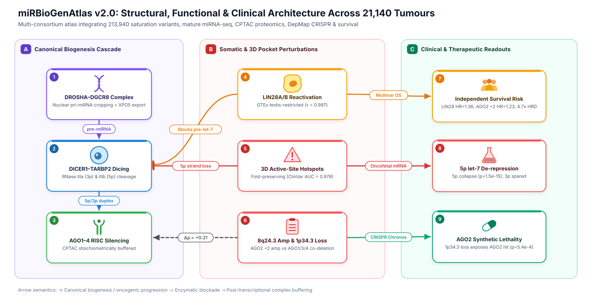

# miRBioGenAtlas (v2.0.2)

**Multi-consortium, structurally and clinically calibrated pan-cancer atlas of the miRNA biogenesis machinery across 21,140 human tumours (`10,195` TCGA PanCanAtlas + `10,945` MSK-IMPACT), matched mature `miRNA-seq` (`N = 9,578`), `13.37M`-pair `miRNA × mRNA` target couplings (`N = 9,353`), `213,940`-variant `ESM-2 3B` / `ESM-1v` / `ESM-IF1` 3D saturation mutagenesis + 16 Cryo-EM/X-ray complexes, `16,569` NCBI ClinVar records (`ROC-AUC = 0.978`), `gnomAD v4`, `GTEx` 54-tissue baselines, `CPTAC` proteomics (`N = 1,002`), and `Broad DepMap` CRISPR (`N = 1,208`)**

[](https://doi.org/10.5281/zenodo.24455067)
[](https://siddugayam.github.io/miRBioGenAtlas/)
[](https://github.com/siddugayam/miRBioGenAtlas/actions/workflows/ci_verify_and_deploy.yml)
[](LICENSE)
[](LICENSE-data.md)
[-informational)](https://www.cbioportal.org)

<p align="center">
  
</p>

---

## Overview

**miRBioGenAtlas (v2.0.2)** provides a frozen, SHA-256-verified, sample-level, variant-level, saturation-mutagenesis, and multi-consortium dataset covering **15 canonical microRNA (miRNA) biogenesis and regulatory genes** across **32 TCGA PanCancer Atlas (2018) studies** (33 cancer types; `COAD = 336` and `READ = 196` combined in `COADREAD = 532`; matched `sequenced ∩ CNA` denominator **`N = 10,195` primary tumours**) replicated across **`N = 10,945` prospective clinical patients** in Memorial Sloan Kettering `MSK-IMPACT` (**`21,140` tumours combined**).

### Key Integrative Layers in v2.0.2
1. **Frozen SHA-256-verified snapshot archive (`data/raw_snapshot/`, `46` verified archives):** Rebuilds every sample-level, variant-level, benchmark, and interactive explorer file **100% offline in ~10 seconds** using only the Python $\ge 3.9$ standard library.
2. **Sample-level TCGA multi-modal table (`152,925` rows = `10,195` samples × `15` genes) + TCGA-CDR Multivariable Survival & Thorsson PanImmune (`10,195 × 62`):** Discrete GISTIC2 (`-2..+2`), continuous `log2CNA`, matched chromosome-arm status (`1p–22q`), somatic mutation tiers, structural variants (`72` calls), matched mRNA `RSEM`/`Z-scores` (`n = 9,620`), hypermutator status (`n = 1,385`), curated TCGA-CDR `OS/DSS/PFI` survival & AJCC stage (evaluated via both cancer-type-stratified Mantel–Haenszel log-rank and exact Breslow multivariable Cox proportional hazards adjusting for age, sex, AJCC stage, and hypermutator status), and Thorsson `C1–C6` immune subtypes, leukocyte fraction, `IFN-gamma`/`TGF-beta` scores, and `HRD` (`n = 9,899`).
3. **Matched TCGA mature `miRNA-seq` (`n = 9,578`) & `13.37M`-pair `miRNA × mRNA` target couplings (`n = 9,353` dual-profiled tumours):** Pre-computed `5p:3p` duplex ratios across `192` batch-corrected canonical `-5p`/`-3p` duplexes (`-0.59 log2` `5p` shift in *DICER1* RNase IIIb 3D pocket variants at $p = 1.46 \times 10^{-15}$ vs $p = 0.35$ for likely benign missense; AGO2-dependent `miR-451a` control $p = 0.97$), plus selective elevation of `5p` `let-7` target mRNAs ($p = 6.53 \times 10^{-5}$; `3p` `miR-200` targets $p = 0.35$) and *LIN28A/B* target mRNAs ($p = 1.75 \times 10^{-31}$).
4. **`213,940`-variant Proteome-Scale Saturation Mutagenesis (`ESM-2 3B`, `ESM-1v`, `ESM-IF1` 3D Inverse Folding, `AlphaMissense`), 16 Cryo-EM/X-ray Complexes & `ClinVar` ROC-AUC (`0.978`):** Atomic heavy-atom distances (`Å`) across **16 experimental human RCSB PDB complexes** + **AlphaFold v6 `pLDDT`**, paired with `ESM-2 (3B)`, `ESM-1v`, and `ESM-IF1` 3D stability across all `11,260` codons (`213,940` substitutions) and validated non-circularly against `612` unambiguous human **NCBI ClinVar** missense assertions (`AlphaMissense` `ROC-AUC = 0.9784`; `>=2-star` `ROC-AUC = 0.9798`).
5. **Independent Clinical Replication (`MSK-IMPACT` `N = 10,945`), Germline Constraint (`gnomAD v4`), Healthy Baseline (`GTEx v10` 54 Tissues), `HPA`, `Open Targets`, `CPTAC` (`N = 1,002`), and `Broad DepMap` CRISPR (`N = 1,208`):** Replicates somatic truncating and 3D-pocket prevalence outside TCGA (`21,140` combined tumours), maps germline `pLI`/`LOEUF`/`mis_Z` and healthy tissue specificity ($\tau = 0.997/0.978$ for *LIN28A/B*), and quantifies CPTAC protein dosage attenuation and DepMap `1p34.3` *AGO1/3/4* $\to$ *AGO2* collateral sensitivity ($p = 5.4 \times 10^{-4}$).
6. **Zero-Backend 3D Structural Portal (`docs/index.html`), Client-Side `GRCh38`/`GRCh37` VCF Translator, Static REST JSON API (`docs/api/v2/`), & CLI (`scripts/query_variant.py`):** Interactive 3D mutant side-chain rotamer viewer (`3Dmol.js`), UniProt domain tracks, `20 AA × sequence` deep mutational scanning (DMS) heatmaps, 2D $C_\alpha$ contact maps, vendored KaTeX mathematical equation reference, `.vcf` / `GRCh38` / `GRCh37` / `c.` HGVS / `rsID` variant triage, 18 CORS-open JSON API endpoints (`https://siddugayam.github.io/miRBioGenAtlas/api/v2/index.json`), and zero-dependency CLI.

---

## Quick Start: Reproducing the Atlas, Querying Variants & Running Tests

### 1. Deterministic offline rebuild & unit-test verification (~10 seconds, zero external packages)
```bash
python3 scripts/build_mirbiogen_v2_dataset.py
python3 scripts/build_web_explorer.py
python3 -m unittest discover -s tests -v
```

### 2. Instant command-line & REST JSON API variant triage (`213,940` substitutions)
```bash
# Query by 1-letter/3-letter protein HGVS, GRCh38/GRCh37 VCF coordinate, or cDNA HGVS:
python3 scripts/query_variant.py DICER1 E1705K
python3 scripts/query_variant.py chr14:95094139:C>T --json
python3 scripts/query_variant.py DROSHA c.3439G>A

# Scan all 19 single-amino-acid substitutions at any catalytic or interface codon:
python3 scripts/query_variant.py --codon DICER1 1705

# Query static CORS-open JSON REST API directly over HTTPS:
curl -sL https://siddugayam.github.io/miRBioGenAtlas/api/v2/genes/DICER1.json | head -c 400
```

### 3. Publication figures (`Figure_1`–`Figure_6` in Vector PDF + 450-DPI LZW TIFF + 300-DPI PNG)
```bash
Rscript miRBioGenAtlas_figures.R
```

### 4. Optional saturation-mutagenesis & target-coupling regeneration (`ESM-IF1` 3D + `213,940`-variant `ESM-2 3B` / `ESM-1v` + `13.37M` pairs)
```bash
python3 scripts/compute_plm_saturation_and_couplings.py --device auto
python3 scripts/build_mirbiogen_v2_dataset.py
```

---

## Data Attribution & Licensing
- **miRBioGenAtlas Data (`data/`, `figures/`, `docs/`):** [CC BY 4.0](LICENSE-data.md) · **Source Code (`scripts/`, `tests/`, `notebooks/`, `*.R`):** [MIT License](LICENSE).
- Primary consortium, clinical, germline, expression, and structural resources are acknowledged from TCGA PanCancer Atlas / TCGA-CDR / PanImmune (NCI GDC / cBioPortal), MSK-IMPACT (`msk_impact_2017`), NCBI ClinVar (`https://www.ncbi.nlm.nih.gov/clinvar/`) & dbSNP (`https://www.ncbi.nlm.nih.gov/snp/`), gnomAD (`https://gnomad.broadinstitute.org/policies`), GTEx Portal v10 (`https://gtexportal.org/home/license`), Human Protein Atlas (`https://www.proteinatlas.org/about/licence`), CPTAC, Broad DepMap / Open Targets Platform (`https://platform-docs.opentargets.org/licence`), UniProtKB (`https://www.uniprot.org/help/license`), RCSB Protein Data Bank (`https://www.rcsb.org/pages/usage-policy`), and AlphaFold Protein Structure Database / AlphaMissense (`https://alphafold.ebi.ac.uk/`).
